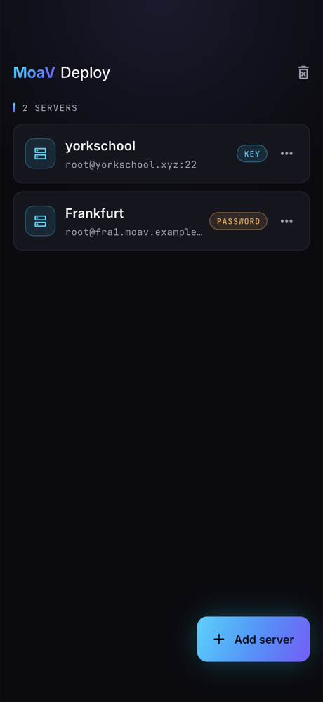
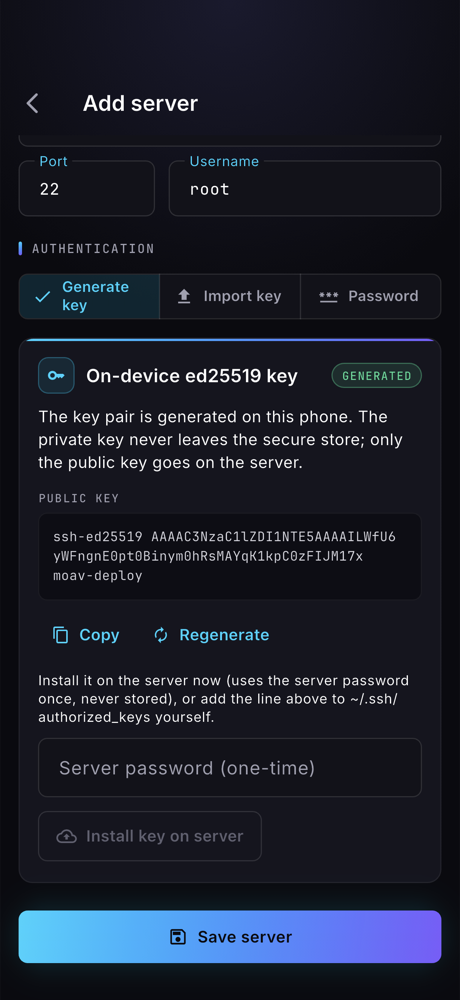
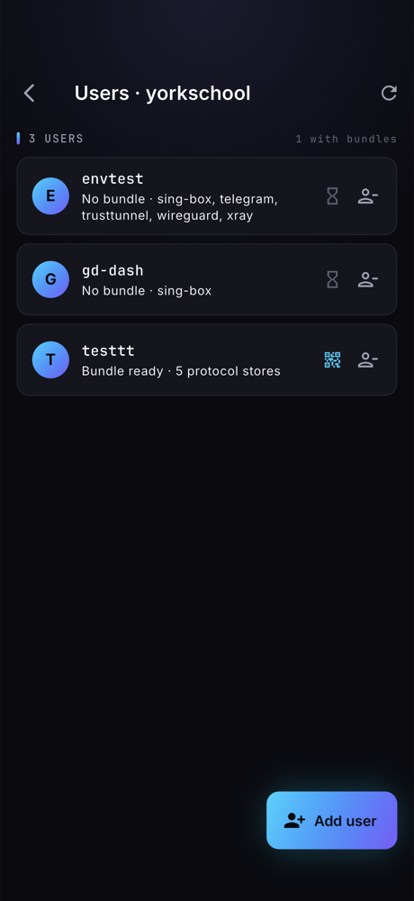
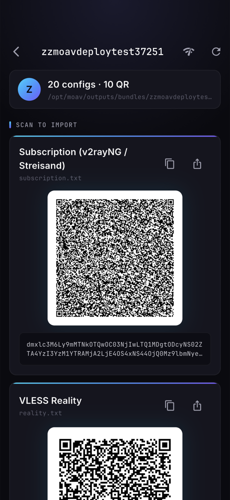
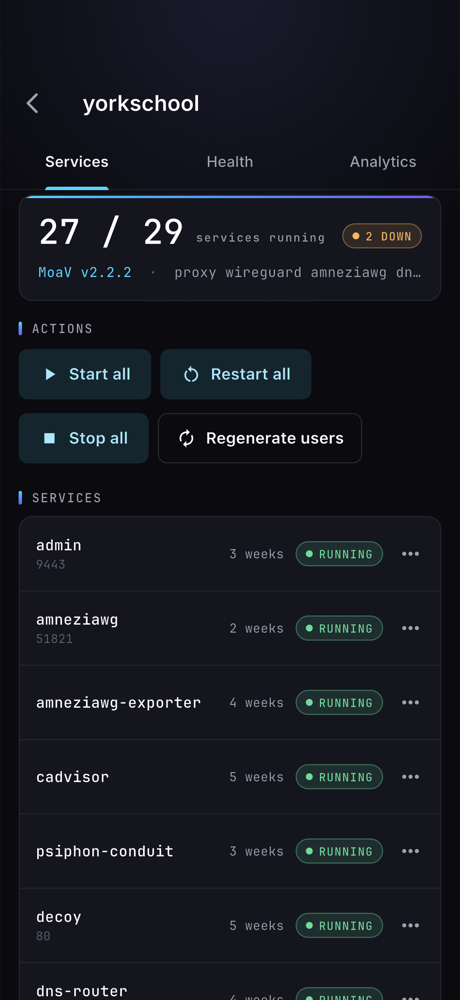
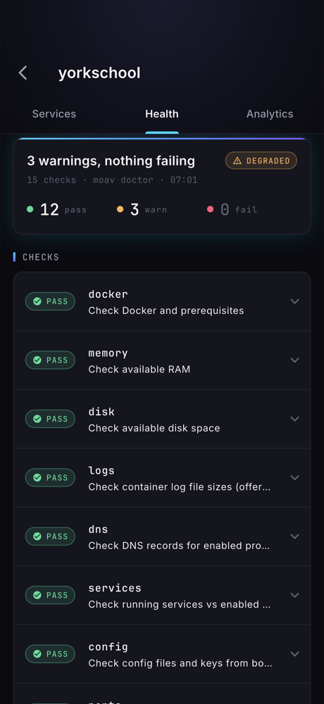
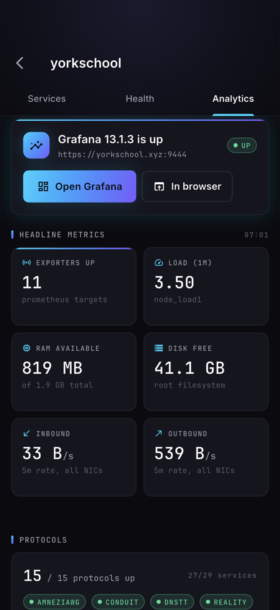
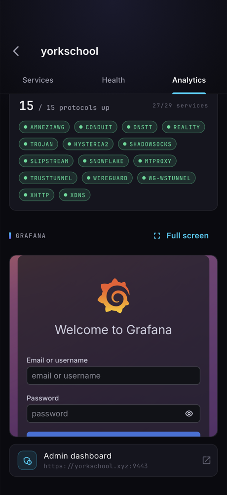
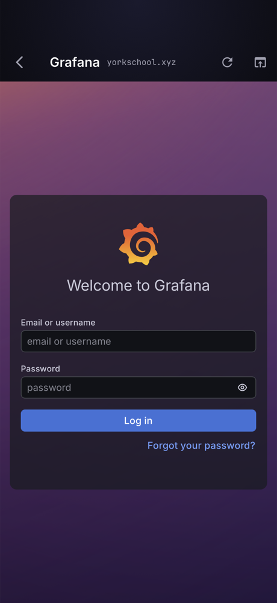

# Screenshot gallery

Captured on an iPhone 18 Pro simulator by `tool/screenshots.sh` against the
real `yorkschool.xyz` box (MoaV v2.2.2, Grafana 13.1.3). The bundle/QR shot
shows a throwaway `zzmoavdeploytest*` user that was revoked right after the
run, so nothing in these images is a live credential.

| | |
|---|---|
|  |  |
|  |  |
|  |  |
|  |  |
|  | |
